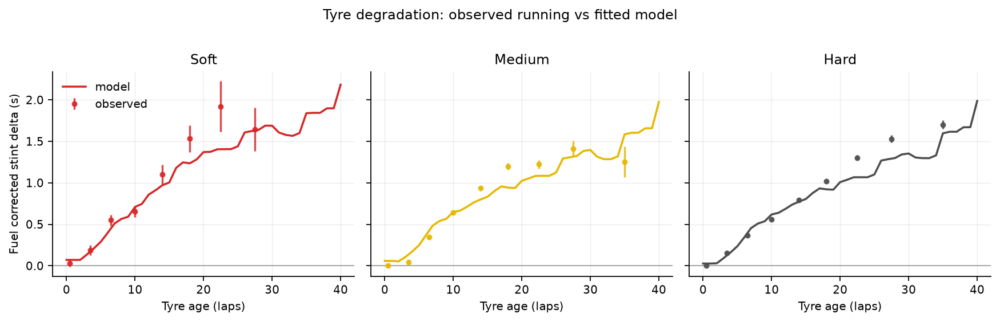
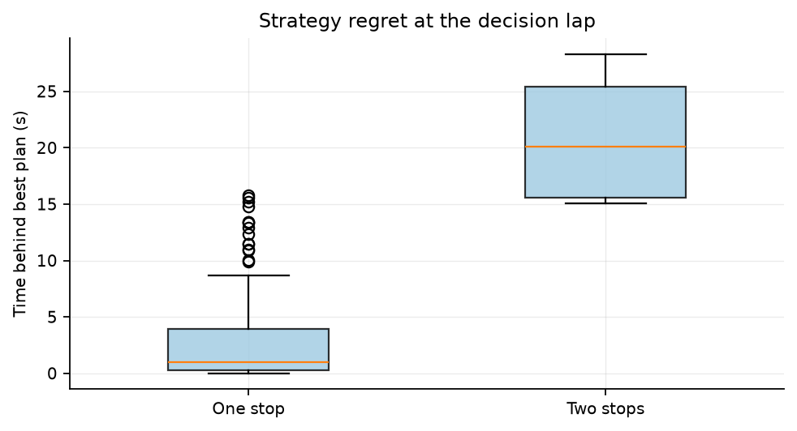

# F1 race strategy

A lap time model and pit stop simulator built on every dry race of the 2024
Formula 1 season. The simulator ranks one and two stop plans from any point in
a race and reports the time each plan is expected to cost.

The project has three parts:

1. A degradation model that predicts how much a stint slows down as the tyres
   wear, with fuel and track effects removed.
2. A strategy simulator that combines those predictions with measured pit stop
   losses and enumerates legal plans.
3. A backtest that replays the season and compares the best plan the model can
   see with the plan the team actually ran.

## Data

Lap times, stints, pit stops, weather and race control messages come from the
public [OpenF1](https://openf1.org/) API. The 2024 season gives 26,543 lap
records across 24 races. Three races (Canada, Britain and Brazil) had enough
rain that a dry tyre model does not apply, so they are excluded from training.
After removing pit laps, safety car laps, in and out laps and clear outliers,
16,097 laps from 21 races remain, covering 824 stints.

The raw table is committed as `data/processed/laps_2024.csv` so the rest of the
pipeline runs without network access. `scripts/build_dataset.py` rebuilds it.

## Why the model looks at deltas and not lap times

Absolute lap times carry the circuit, the car, the fuel load and the amount of
rubber on the track. A model trained on them does not transfer to a circuit it
has never seen. Two corrections fix that.

**Fuel.** A lap gets faster as the car burns fuel. The sensitivity is estimated
from the data: take laps on fresh tyres, remove session and compound means, and
regress lap time on fuel mass. That gives 0.0359 s per kg, or about 3.9 s over a
full 110 kg tank. The estimate is stable at every tyre age from 1 to 12, which
is a good sign that it is not picking up degradation.

**Stint reference.** Each lap is then expressed relative to the pace of the same
stint on fresh tyres. The target becomes "how much slower is this lap than the
first laps of this stint", which is the quantity a strategy decision depends on.
Track evolution, fuel and the car's base pace cancel out. For pit planning they
also cancel between plans, which is why the simulator can rank strategies using
degradation alone.

Features are tyre age, tyre age squared, compound, and track and air temperature
relative to the race median. Absolute temperatures were left out because they
act as a shortcut for race identity and do not transfer to a new circuit.

## Model results

Three regressors were compared with grouped cross validation where a whole race
is held out in each fold.

| Model | MAE (s) | RMSE (s) | R2 |
| --- | --- | --- | --- |
| Ridge | 0.690 | 0.950 | 0.216 |
| Random forest | 0.719 | 0.988 | 0.153 |
| XGBoost | 0.715 | 0.981 | 0.164 |

XGBoost is used for the final artifact because it captures the non-linear
degradation shape and the compound interaction. Its holdout error on four
unseen races (Spielberg, Monza, Baku, Lusail) is 0.699 s MAE over 2,933 laps.

A single lap is a noisy measurement. Traffic, driver mistakes and momentary
loss of grip all move a lap by several tenths. The number that matters for
strategy is the expected pace of a tyre at a given age, so the table below
compares predicted and observed mean pace in bins of compound and tyre age.
There the error falls to 0.25 s on the holdout races.

| Compound | Holdout laps | MAE (s) | Bias (s) |
| --- | --- | --- | --- |
| Soft | 22 | 1.47 | +1.47 |
| Medium | 946 | 0.68 | -0.09 |
| Hard | 1,965 | 0.70 | +0.24 |

The soft sample is too small to say much. The holdout races were mostly medium
and hard races, which is a limitation of splitting by race.



The fitted curves are close to the binned running in every compound. Hard tyres
lose about 1.3 s after 30 laps, mediums lose about 1.3 s, and softs lose about
1.5 s. The curves flatten at high age because few stints go beyond 35 laps, so
the model should not be trusted there. That is one reason the simulator refuses
plans that exceed the observed tyre life.

## Pit losses

Pit loss is measured per circuit from every stop in the season. For each stop,
the pit in lap and the out lap are compared with the driver's nearby clean laps,
using a local reference so that fuel load does not distort the number. Across
the season the median loss runs from 17.9 s at Spa to 35.6 s at Silverstone,
where the pit lane is unusually long. The per-circuit table is in
`data/processed/pit_losses.csv`.

## Strategy simulator

From a race state (lap, compound, tyre age) the simulator enumerates every legal
plan with up to two stops. It enforces the two compound rule, a minimum stint
length of four laps, and a tyre life limit taken from the 99th percentile of
observed stint lengths (23 laps for soft, 31 for medium, 41 for hard). Plans are
scored on summed degradation plus pit loss. Everything common to all plans
cancels.

```
$ f1strategy strategy --race 1 --driver VER --lap 30 --top 5
Round 1: Sakhir (Sakhir), 57 laps
VER on lap 30, Hard at 12 laps old
Baseline pace 92.476s, pit loss 23.1s, track 22.8C

 rank                plan  stops  cost_s  gap_to_best_s
    1    no further stops      0   32.25           0.00
    2  lap 37 to Medium      1   39.89           7.64
    3  lap 38 to Medium      1   39.96           7.71
    4  lap 36 to Medium      1   40.00           7.74
    5  lap 39 to Medium      1   40.05           7.80
```

The `--figure` flag writes a cost map over pit laps and compounds, plus a
cumulative trace for the leading plans.

## Backtest

At lap 30 of every race the model ranks plans against the plan the team actually
ran. Of 379 driver races, 198 actual plans satisfy the same constraints the
simulator uses (two compound rule, minimum stint, tyre life), which is what makes
the comparison fair.

| Metric | Value |
| --- | --- |
| Valid comparisons | 198 |
| Median regret | 0.00 s |
| Mean regret | 1.80 s |
| Median regret, no safety car after lap 30 | 0.00 s |
| Mean regret, no safety car after lap 30 | 2.60 s |
| Same number of stops as the model | 86% |

Half of the comparisons show no regret at all, which means the model would have
picked the same number of stops and a similar window. The mean is pulled up by a
handful of races where the team stopped late for a safety car or where the model
kept a tyre alive longer than the team did.



## What this does not do

- Safety cars, virtual safety cars and red flags are not modelled. A stop under
  a safety car costs much less, and the simulator only knows the green flag pit
  loss.
- Traffic, dirty air, the undercut and track position are ignored. Two plans
  that cost the same time are treated as equal even if one puts the car in a
  train of slower cars.
- The tyre life limits are empirical, not physical. The model has little data
  beyond 40 laps on a hard tyre.
- Compound offsets are small in this dataset. The model reflects the 2024
  running, where the medium was often the best race compound. It does not know
  that a particular circuit's soft is a qualifying tyre.
- Wet running is out of scope.

## Running it

```
python -m venv .venv
source .venv/bin/activate        # Windows: .venv\Scripts\activate
pip install -e ".[dev]"

make data       # download the 2024 season from OpenF1 (cached)
make train      # fit the model, write artifacts and figures
make backtest   # replay the season at lap 30
make test
```

Or without make:

```
python scripts/build_dataset.py --year 2024
python scripts/train_model.py
python scripts/run_backtest.py --lap 30
pytest
```

The committed artifacts mean the CLI works straight after `pip install`. The
training script regenerates them.

## Layout

```
src/f1strategy/
  openf1.py     cached API client
  dataset.py    raw lap level table with pit and safety car flags
  features.py   fuel correction, stint delta, feature set
  model.py      training, grouped CV, holdout metrics, persistence
  predictor.py  vectorised prediction adapter for the simulator
  strategy.py   plan validation and enumeration
  pitloss.py    measured pit stop losses
  backtest.py   season replay and regret calculation
  plots.py      report figures
  cli.py        command line entry point
scripts/        dataset build, training, backtest
tests/          unit and integration tests
data/           processed lap table and pit losses
artifacts/      trained model, metrics, backtest output
reports/        figures and metric dumps
```

## License

MIT. The data belongs to Formula 1 and is accessed through the public OpenF1
API. This project is not affiliated with Formula 1 or any team.
